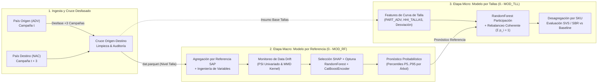

# 📦 Sistema Jerárquico de Pronóstico de Demanda Cross-Country (Lead-Lag Forecasting) — Retail & Venta Directa


---

## 🎯 Resumen Ejecutivo y Problema de Negocio

En la industria de **Venta Directa por Catálogo y Fast Fashion**, la planificación de inventarios enfrenta un desafío crítico de *Cold Start*: en cada campaña comercial (18 campañas anuales), una alta proporción del catálogo corresponde a **lanzamientos de productos nuevos** sin historial previo de ventas locales. Un error de pronóstico impacta directamente en dos costos contrapuestos de la cadena de suministro:
1. **Quiebres de stock (Pérdida de Nivel de Servicio — `SVS`)**: Demanda insatisfecha por subestimación.
2. **Sobreinventario (Sobrante — `SBR`)**: Capital inmovilizado y liquidación forzosa por sobreestimación.

Este proyecto implementa una **arquitectura jerárquica de Machine Learning en dos etapas (Referencia $\rightarrow$ Talla)** que explota la **estructura de rezago internacional (*Lead-Lag Cross-Market Forecasting*)**: utiliza el comportamiento real de la demanda anticipada (**Advance / `ADV`**) en un país origen líder (ej. **Colombia** o **Perú**) para predecir la demanda nacional (**Nacional / `NAC`**) en un país destino (ej. **Guatemala**, **Ecuador** o **Bolivia**) con un desfase operativo de **$k = 3$ campañas**.

---

## 🏗️ Arquitectura del Sistema (Two-Stage Hierarchical Forecasting)

El sistema desacopla el problema de **volumen agregado del diseño** (Nivel Referencia SAP) del problema de **distribución de curva de tallaje** (Nivel SKU / Talla), garantizando coherencia probabilística en todos los cuantiles del pronóstico:



### Etapa 1: Modelo Macro a Nivel Referencia (`0.- MOD_RF`)
* **Objetivo**: Predecir la tasa de conversión de demanda entre el país origen y el país destino a nivel de referencia de producto (`CAMP_NOMBRE_SAP`), modelando la transformación logarítmica del ratio de factores:
  $$y = \ln\left(\frac{\text{FAC\_NAC}}{\text{FACT\_ADV\_RGN}}\right)$$
* **Estimación de Incertidumbre (Cuantiles Empíricos)**: En lugar de emitir únicamente una predicción puntual, el modelo extrae las predicciones individuales de los $B$ árboles del ensamble (`rf.estimators_`), invierte la transformación a escala real de unidades/factor y construye la distribución empírica completa por producto (`LIM_INF` [P5], `Q_10`, `Q_20`, ..., `Q_50` [Mediana], ..., `Q_90`, `LIM_SUP` [P95]) junto con el índice de dispersión `Q70_Q30`.

### Etapa 2: Modelo Micro de Reparto por Tallas (`0.- MOD_TLL`)
* **Objetivo**: Predecir la cuota de participación de cada talla (`PART_NAC`) dentro de su referencia comercial a partir de la curva observada en el país origen (`PART_ADV`), la concentración del tallaje (`HHI_TALLAS`) y la desviación histórica de la talla.
* **Reconciliación Jerárquica Coherente**: Las predicciones de participación por talla se normalizan por referencia ($\sum_{t \in \text{Ref}} \hat{p}_t = 1$) y se multiplican por cada cuantil estimado en la Etapa 1, asegurando que la suma de los pronósticos por SKU devuelva exactamente el volumen pronosticado de la referencia.
* **Benchmarking Riguroso**: El pipeline evalúa automáticamente si el modelo de Machine Learning (`TALLAS_RF`) supera en test al *baseline* heurístico de negocio (`TALLAS_BASELINE`: repartir exactamente con la proporción cruda del país origen).

---

## 🧠 Ingeniería de Variables y Prevención de *Data Leakage*

El pipeline construye **+35 variables predictoras** diseñadas específicamente para capturar dinámicas comerciales de catálogo, elasticidad de precios y estacionalidad:

| Familia de Variables | Variables Destacadas | Lógica de Negocio y Diseño Técnico |
| :--- | :--- | :--- |
| ** Señales del País Líder (ADV)** | `FACT_ADV_RGN`, `FACTOR_MAX`, `FACTOR_MIN`, `FACTOR_MEDIANA` | Capturan la tracción comercial del producto 3 campañas antes en el país origen y su dispersión regional (ej. Bogotá, Costa, Occidente, Santander en Colombia; Lima, Costa, Sierra, Selva en Perú). |
| ** Momentum Temporal (Leak-Free)** | `MOMENTUM_SUBGRUPO_LAG_3`, `MOMENTUM_REF_LAG_3`, `ANOMALIA_RATIO_SUBGRUPO`, `DESVIACION_TALLA_LAG_3` | Promedios móviles calculados estrictamente sobre campañas pasadas (`shift(1).rolling(3)`). Para referencias nuevas (*Cold Start*), aplica imputación jerárquica por ventana expansiva acumulada (`expanding().mean()`) evitando *Data Leakage* del conjunto de prueba. |
| ** Concentración (Índice HHI)** | `HHI_CLIMA_ORIGEN`, `HHI_TALLAS` | Aplicación del **Índice de Herfindahl-Hirschman** ($\sum s_i^2$) para cuantificar la concentración de la demanda por perfil climático en la campaña y la polarización de la curva de tallas. |
| ** Presión Competitiva y Precio** | `RATIO_PRECIO`, `PRECIO_PROMEDIO_COMPETIDORES_*`, `EXPOSICION_*`, `RATIO_EXPOSICION` | Mide el posicionamiento relativo de precio frente a competidores de la misma categoría/subgrupo y la saturación visual de productos por página del catálogo. |
| ** Ubicación en Catálogo y Ciclos** | `UBICACION_PAG_MIX`, `CAMBIO_PAG_LADO`, `ESTR_MIX`, `CAMP_SEN`, `CAMP_COS` | Codifica transiciones de ubicación en el catálogo (páginas iniciales vs. finales, página derecha/par vs. izquierda/impar) y estacionalidad cíclica anual ($\sin/\cos$ sobre 18 campañas). |

---

## 🔬 Metodología de Ciencia de Datos y MLOps

### 1. Monitoreo Automatizado de *Data Drift* (Univariado y Multivariado)
Antes de ejecutar la optimización de hiperparámetros, el pipeline audita la estabilidad estadística entre la ventana de entrenamiento (`TRAIN`) y validación temporal (`TEST`) mediante el módulo [`data_drift.py`](0.-%20MOD_RF/3.-%20src/models/data_drift.py):
* **PSI (*Population Stability Index*)**: Evalúa el desplazamiento univariado por cuantiles para cada predictor numérico y categórico, clasificando alertas en `OK` ($\text{PSI} \le 0.1$), `ALERTA` ($0.1 < \text{PSI} \le 0.2$) y `PELIGRO` ($\text{PSI} > 0.2$).
* **MMD (*Maximum Mean Discrepancy*) con Test de Permutaciones**: Mide la discrepancia multivariada en espacios de Hilbert reproducibles (RKHS) mediante un kernel Gaussiano (RBF) calibrado con la **heurística de la mediana** y un test exacto de permutaciones de Monte Carlo para estimar el $p$-valor de cambio estructural entre distribuciones, complementado con proyecciones **PCA 2D**.

### 2. Selección de Variables Multi-Enfoque
El repositorio integra cuatro mecanismos complementarios para selección y auditoría de predictores:
1. **SHAP Feature Importance (`TreeExplainer`)**: Selección automatizada del Top-$K$ de variables basada en el impacto marginal absoluto medio ($\mathbb{E}[|\phi_j|]$) en [`entrenamiento_utils.py`](0.-%20MOD_RF/3.-%20src/models/entrenamiento_utils.py).
2. **Boruta con Estabilidad Bootstrap**: Selección por variables sombra (*shadow features*) con remuestreo bootstrap para retener únicamente predictores con estabilidad $\ge 85\%$.
3. **Búsqueda Combinatoria Exhaustiva ($2^K - 1$)**: En [`6.- experimentos_nube/RF NUBE.py`](0.-%20MOD_RF/6.-%20experimentos_nube/RF%20NUBE.py), evalúa paralelamente miles de subconjuntos de variables para mapear la frontera de Pareto entre Nivel de Servicio (`SVS`) y Sobrante (`SBR`).
4. **Ablación *Leave-One-Out***: En [`RF NUBE QUITANDO X.py`](0.-%20MOD_RF/6.-%20experimentos_nube/2.-%20LEAVE_ONE_OUT_VARIABLES/RF%20NUBE%20QUITANDO%20X.py), cuantifica la degradación marginal en métricas de negocio al retirar una variable a la vez.

### 3. Optimización Bayesiana y Ponderación Temporal Exponencial
* **Pipeline de Preprocesamiento**: Encapsulado en `scikit-learn` mediante `ColumnTransformer` (`StandardScaler` para variables continuas + `CatBoostEncoder` para variables categóricas de alta cardinalidad) acoplado a `RandomForestRegressor`.
* **Tuning con Optuna (`TPESampler`)**: Optimización bayesiana de hiperparámetros estructurales (`n_estimators`, `max_depth`, `min_samples_leaf`, `min_samples_split`, `max_features`) y de la tasa de decaimiento temporal (`decay_rate`).
* **Time-Decay Sample Weighting**: Soporte para ponderación exponencial por antigüedad de campaña ($w_i = \exp(-\lambda \cdot \Delta \text{campaña}_i)$) para mitigar el impacto de cambios de régimen macroeconómicos o comerciales antiguos.

### 4. Evaluación con Métricas de Cadena de Suministro
Además de métricas estadísticas tradicionales ($R^2$, $\text{MAE}$, $\text{RMSE}$, $\text{MAPE}$), los modelos se seleccionan y auditan bajo métricas operativas de inventario:
* **Nivel de Servicio (`SVS`)**:
  $$\text{SVS} = \frac{\sum_{i} \min(\hat{y}_i, y_i)}{\sum_{i} y_i}$$
* **Porcentaje de Sobrante (`SBR`)**:
  $$\text{SBR} = \frac{\sum_{i} \max(\hat{y}_i - y_i, 0)}{\sum_{i} y_i}$$
* **Score Compuesto Penalizado por Volatilidad**:
  $$\text{Score} = \text{SVS} - 3 \cdot \text{SBR} - 0.5 \cdot (\sigma_{\text{SVS}} + \sigma_{\text{SBR}})$$

---

## 📂 Estructura del Proyecto

El repositorio sigue el estándar industrial **Cookiecutter Data Science**, replicado simétricamente para el módulo de Referencia (`0.- MOD_RF`) y el módulo de Tallas (`0.- MOD_TLL`), gobernados desde un único archivo de configuración central (`config_proyecto.py`):

```text
MODELO_AZZORTI_ROP_ADV_NAC/
│
├── config_proyecto.py                  # Parámetros globales (país origen/destino, línea, desfase, cortes temporales)
├── correr_madrugada.py                 # Orquestador batch para experimentos automatizados (Con/Sin Time Decay)
├── COMO_USAR_PLANTILLA.md              # Guía técnica de adaptación a nuevos pares de países y líneas comerciales
├── README.md                           # Documentación principal del proyecto
│
├── 0.- MOD_RF/                         # ETAPA 1: Modelo Macro por Referencia SAP
│   ├── 0.- data/                       # Estructura de datos (raw / interim / processed) y consolidador BI
│   ├── 1.- references/                 # Diccionarios y reglas de negocio de subgrupos/categorías
│   ├── 2.- notebooks/                  # Suite de 10 módulos de EDA, diagnóstico SHAP, Drift y Estacionalidad
│   │   ├── 1.- exploracion.py          # Auditoría de cardinalidad y nulos en tablas crudas
│   │   ├── 2.- features.py             # Inspección de variables creadas a nivel referencia
│   │   ├── 3.- modelado.py             # Diagnóstico visual pre-modelado y detección de outliers
│   │   ├── 4.- diagnostico_shap.py     # Explicabilidad local y global con valores SHAP
│   │   ├── 5.- diagnostico_ratio_precio.py # Análisis de elasticidad y evolución de precios relativos
│   │   ├── 6.- validacion_temporal.py  # Curvas de aprendizaje y estabilidad de cortes temporales
│   │   ├── 7.- analisis_drift.py       # Ejecución y visualización de PSI y MMD + PCA
│   │   ├── 8.- eda_variables.py        # Ranking por Información Mutua, correlaciones y distribuciones
│   │   ├── 9.- eda_estacionalidad.py   # Descomposición estacional, efecto clima y campañas pico
│   │   └── 10.- eda_volumetria.py      # Simulación de sensibilidad de ventanas históricas Train/Test
│   ├── 3.- src/                        # Código fuente modularizado
│   │   ├── config.py                   # Gestión de rutas relativas OOP (pathlib) y factores regionales
│   │   ├── data/                       # Ingesta, limpieza, filtrado de faltantes/atípicos y bitácoras
│   │   ├── features/                   # Ingeniería de variables cross-country, momentum y clima
│   │   ├── models/                     # Pipeline sklearn, Optuna, SHAP, Data Drift y evaluación por árbol
│   │   └── visualization/              # Funciones estandarizadas de visualización estadística y de negocio
│   ├── 4.- models/                     # Artefactos serializados (.pkl)
│   ├── 5.- reports/                    # Reportes automatizados de auditoría, filtros y gráficos
│   └── 6.- experimentos_nube/          # Búsqueda combinatoria exhaustiva (2^k - 1) y Leave-One-Out
│
└── 0.- MOD_TLL/                        # ETAPA 2: Modelo Micro de Desagregación por Tallas (SKU)
    ├── 0.- data/                       # Consolidación conjunta Referencia vs. Tallas para Power BI
    ├── 3.- src/                        # Pipeline de participación por talla, HHI, rebalanceo y benchmarking
    ├── 4.- models/                     # Pipeline serializado de participación por talla (.pkl)
    └── 5.- reports/                    # Comparativas SVS/SBR: Referencia vs. Tallas RF vs. Baseline
```

---

## 🚀 Flujo de Uso y Ejecución

### 1. Configuración Centralizada
Todos los parámetros de corrida se definen en un único punto ([`config_proyecto.py`](config_proyecto.py)) para garantizar consistencia estricta entre el modelo de referencia y el de tallas:

```python
PAIS_DESTINO = 'GUA'       # Mercado objetivo a pronosticar (NAC): 'GUA', 'ECU', 'BOL', 'PER', 'COL'
PAIS_ORIGEN = 'COL'        # Mercado líder anticipado (ADV): 'COL', 'PER'
LINEA = 'REX'              # Línea comercial: 'REX' (Ropa Exterior) o 'RIN' (Ropa Interior)
DESFASE_CAMPANAS = 3       # Rezago operativo en campañas entre origen y destino

CAMP_INI = 202201          # Ventana histórica para extracción y cálculo de rezagos/EDA
CAMP_INI_MODELO = 202201   # Ventana efectiva de entrenamiento
CAMP_FIN = 202614          # Última campaña disponible
CORTE_TRAIN_TEST = 202512  # Split temporal estricto (Train < corte | Test >= corte)
```

### 2. Ejecución Secuencial del Pipeline
1. **Entrenar el Modelo por Referencia (Etapa 1)**:
   ```bash
   python "0.- MOD_RF/3.- src/models/entrenar.py"
   ```
   *Ejecuta la ingesta, limpieza con trazabilidad en Excel (`FILTROS.xlsx`), generación de la base limpia por talla (`dat.parquet`), ingeniería de variables por referencia, auditoría de Data Drift (PSI/MMD), optimización con Optuna, cálculo de percentiles por árbol y exportación de predicciones.*

2. **Entrenar el Modelo de Reparto por Tallas (Etapa 2)**:
   ```bash
   python "0.- MOD_TLL/3.- src/models/entrenar.py"
   ```
   *Consume `dat.parquet` y el pronóstico de la Etapa 1, entrena el modelo de participación por talla, aplica el rebalanceo coherente ($\sum \hat{p}_t = 1$), reparte todos los percentiles a nivel SKU y genera el reporte comparativo `REFERENCIA` vs. `TALLAS_RF` vs. `TALLAS_BASELINE`.*

---

## 🛠️ Stack Tecnológico

* **Lenguaje y Procesamiento**: `Python 3.11+`, `NumPy`, `Pandas`, `PyArrow (Parquet)`
* **Machine Learning & Pipelines**: `Scikit-Learn`, `Category Encoders (CatBoostEncoder)`
* **Optimización y Selección de Variables**: `Optuna (Bayesian TPE)`, `SHAP (TreeExplainer)`, `BorutaPy`
* **Estadística y Series de Tiempo**: `Statsmodels (Seasonal Decompose)`, `RKHS Kernel MMD`, `Population Stability Index (PSI)`
* **Visualización y BI**: `Matplotlib`, `Seaborn`, `OpenPyXL`, `Power BI`

---

## 👤 Autor

**Mauricio Aguirre**  
*Data Scientist | Machine Learning & Demand Forecasting*  
🔗 [GitHub: @MrPinkiePie](https://github.com/MrPinkiePie)
